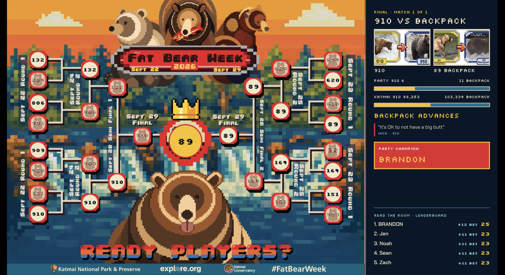
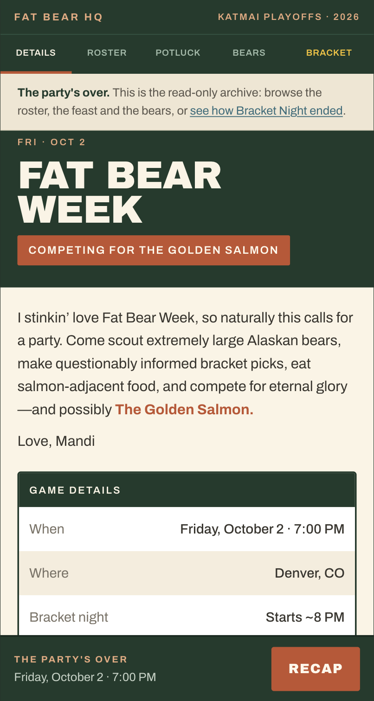
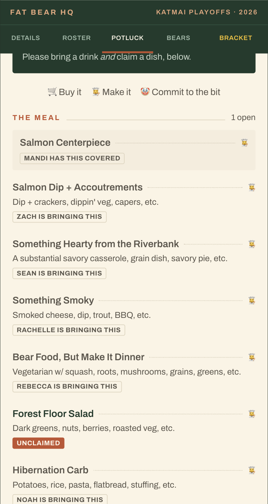
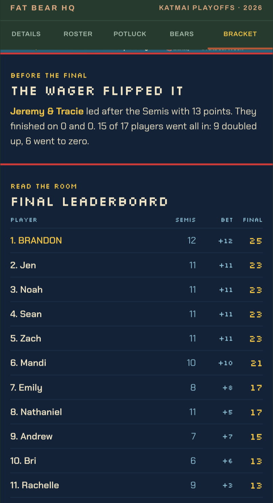
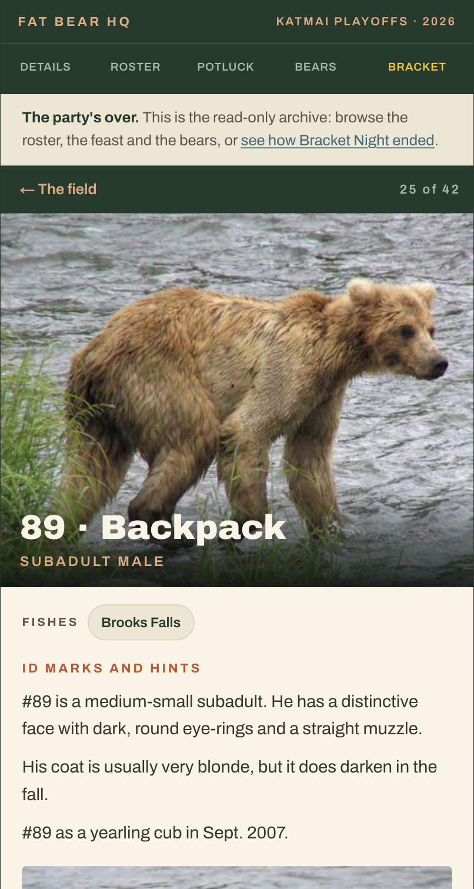

# Fat Bear Week HQ 🐻🐟

**A custom party app for a real Fat Bear Week watch party: one link for invites, RSVPs, potluck and a bear field guide, and on the night itself, a live bracket game played on phones and the TV.**

Built for one evening, about 20 friends, and one deadline: Friday, October 2, 2026.

**[Explore the archived party →](https://fatbear.sprigbo.com)** · [See how Bracket Night ended](https://fatbear.sprigbo.com/bracket/recap)

<p align="center">
  
</p>
<p align="center">
  
  &nbsp;
  
  &nbsp;
  
</p>

*Real screenshots of the real party, taken after it ended.*

---

## What it is

Every fall, Katmai National Park runs [Fat Bear Week](https://explore.org/fat-bear-week): a public bracket where people vote for the brown bear that fattened up most for winter. I wanted to throw a party around it. The party needed the usual logistics: who's coming, who's bringing what. It also needed a way to make a few dozen very similar-looking bears approachable to people who had never watched the bear cams.

So instead of a group text and a spreadsheet, I built a small app with the personality of the event. Its look is a vintage wilderness sporting club crossed with a sports broadcast. It did two jobs:

- **Before the party:** an invite that doubles as RSVP, a potluck sheet, a field guide to the bears, and live Katmai cams.
- **At the party:** **Bracket Night**, a host-run live game. Guests vote on their phones, the TV reveals results match by match, and a champion takes home the Golden Salmon.

The party has happened. The live site is now a read-only archive of the real night: the real roster, the real potluck, the real votes and the real winner.

## What it does

### 🎟 One link, no accounts
The host texts one URL. A guest picks their name from the list, or adds it, and taps **I'm in**. No password, no sign-up, no app to install. They can come back to change their answer, say how many people they're bringing, and declare a bear allegiance for pre-party trash talk.

### 🍽 A holiday-themed potluck that plans itself
A curated menu of on-theme food (salmon, smoke, berries, honey, anything bear- or forest-shaped). Each dish can be claimed once, enforced by a database constraint, so two people can't both sign up for the gummy bears.

### 🐻 A field guide to the bears



Profiles for 42 Brooks River bears from the NPS photo guide: how to identify each one, where they fish, and their Fat Bear Week record. The live cams sit alongside, so guests can find a bear in the guide and then watch it fish.

<br clear="right" />

### 🏆 Bracket Night
The centerpiece: a live, host-paced game for the room. It runs on three screens at once.

| Screen | Who | What it does |
| --- | --- | --- |
| **Phone** | Every guest | Join with one tap, vote on each matchup, post a line of trash talk per match, place a Final Wager |
| **TV** | The room | The official bracket poster fills in live as results are revealed |
| **Press Box** | The host | A remote for pacing the night: open voting, lock the round, reveal, undo |

The scoring rule is **Read the Room**. You score by voting with the party majority, not by predicting Katmai's real winner. The official 2026 results were already public by party night, so scoring against them would just reward looking them up. Read the Room makes the game about reading your friends instead. Katmai's real count still decides which bear advances, so the bracket stays true to the real thing.

The night closes with a Final Wager and a tiebreaker question, if one is needed. Afterwards, an auto-generated **recap** covers the champion, the upsets, the closest matches, the all-in bets, superlatives and the quote of the night. On the night, 17 players took part. 15 of them went all in on the Final Wager, and that flipped the lead.

## How I approached it

**Optimize for the room, not for scale.** The audience was about 20 friends, so every feature asked how little the guest would have to do. Identity is "tap your name," and that is a deliberate choice. Accounts would have cost more participation than they protected. The host controls sit behind a shortcut link, not a login. That tradeoff only works for a small, trusted group, and the archive mode described below closes it once the party is over.

**Design around a fixed date.** The party was on October 2, and nothing could slip. The coordination features shipped first, roughly two and a half weeks before the party, so invitations could go out (Sept 12–14 in the commit history). Bracket Night came last, on the evening of the party. The game was built so the host could rehearse it alone: **rehearsal mode** fills the room with bots that vote, talk trash and bet, and the host can jump straight to the Semifinal or the Final to test the endgame.

**Pair the practical with the delightful.** The potluck sheet is a sign-up form with jokes in it. The bear guide gives non-fans enough context to have opinions. The status card tells you "YOU'RE ON THE ROSTER." The same logistics a spreadsheet would handle are presented as part of the event.

**Use phones to serve an in-person moment.** Bracket Night is not something to play alone at home. The phones are controllers, the TV is the shared stage, and the host sets the pace, like a game-show host. Results reveal in two beats, first the party's vote and then Katmai's real count, so the room reacts together.

**Leave a record.** The recap page was built the morning after. Archive mode then freezes everything, so anyone can explore what actually happened that night without being able to change it.

## How it was built

My role was the product concept, the requirements, the interaction and visual direction, the game rules, evaluating what got built, the decisions and tradeoffs, and testing. I also ran the event (and baked a truly excellent cake). Much of the code was written by Claude Code agents under my direction (Claude Sonnet and Opus models), and I reviewed, steered and accepted their changes. The commit history carries those co-author trailers.

The workflow went like this:

1. **Explore the design with Claude Design.** I directed the visual brand and interface over multiple rounds of iteration in Claude Design, ending with high-fidelity, interactive HTML prototypes with exact copy, colors and behavior.
2. **Hand off a written brief.** Once the design was set, Claude Design produced a design handoff and implementation brief for Claude Code. Those prototypes and briefs are in [`design-reference/`](design-reference/design_handoff_fat_bear_week). The Bracket Night brief ([`UPDATE-5-bracket-night.md`](design-reference/design_handoff_fat_bear_week/UPDATE-5-bracket-night.md)) is the clearest example: game model, scoring rules, edge cases and what the host sees at each step.
3. **Build in the real stack with Claude Code.** Each prototype faked persistence in `localStorage`. The briefs explicitly asked for real server-side state.
4. **Iterate in small commits**, with later design updates layered on top (`UPDATE-2` through `UPDATE-5`).

### Architecture

```
Next.js 16 (App Router, Server Components, Server Actions) on Vercel
  ├─ Invite / RSVP / Potluck / Bears ── Server Actions ──┐
  ├─ Bracket Night phone, TV, Press Box ── poll JSON API ─┤
  │                                                       ▼
  │                                   Neon Postgres via Drizzle ORM
  └─ src/lib/bracket/engine.ts: pure game logic (no I/O), unit-tested
```

Some decisions that shaped it:

- **The game engine is pure functions.** Scoring, reveals, wagers, tiebreakers, undo and bot behavior live in `engine.ts`, with no database or framework code. The persistence layer (`store.ts`) takes the database as an argument, so the tests run the same code against an in-memory Postgres ([PGlite](https://pglite.dev)).
- **Concurrency is optimistic.** The game is one row with a version number. Every host action is a compare-and-set, so a double tap or two host devices can't skip a step. The host has a full **undo** history for mistakes made live.
- **Polling, not WebSockets.** Phones and the TV poll about once a second. With about 25 clients that's simple and robust. A 350 ms in-memory cache on the server collapses those polls into a few database reads per second.
- **Reliability where it mattered.** Bear photos and the official results are stored in the repo, so the game didn't depend on a third-party site staying up during the party.
- **Archive mode.** Setting one environment variable turns the deployment into a read-only record. See below.

## What I learned

- **Writing the spec is the work.** The parts of the app that came out right the first time were the parts I specified most precisely: the bracket game model, the reveal states, the edge cases. AI implementation made the gap between "clear spec" and "vague spec" obvious and immediate.
- **A rule change can be the best feature.** The obvious bracket game ("predict the winners") was broken, because the answers were public. Changing the rule to Read the Room fixed it without adding code complexity, and arguably made the game more social.
- **Rehearsal is a product feature.** A live event gets one shot. Bots, jump-to-round and undo were what made it possible to rehearse the night alone ahead of time.
- **"No auth" is a decision that needs an expiry.** The trust model that made sense for 20 friends on one night didn't make sense for a public link afterwards. Archive mode is how I closed it, without adding accounts.

<!-- ADD: anything you observed on the night (what worked, what surprised you), stated only as you experienced it -->

---

## Technical details

**Stack:** Next.js 16 · React 19 · TypeScript · Tailwind CSS 4 · Drizzle ORM · Neon Postgres · Vitest + PGlite · Vercel

### Run it locally

```bash
npm install
cp .env.example .env.local   # then set DATABASE_URL to a Postgres database
npm run db:push              # create the tables
npm run dev                  # http://localhost:3000
```

Add `?host` to any URL to become the host on that browser (see *Limitations*).

### Tests

```bash
npm test               # engine, persistence, finale, join, status, view, potluck and archive-mode tests
npm run bracket:sim    # plays a full 10-bot Bracket Night and prints the game
npm run lint
npx tsc --noEmit
```

The persistence tests run against in-memory Postgres, so they need no database or network.

### Archive mode

```bash
FBW_ARCHIVED=1   # set on the deployment, then redeploy
```

When set, the server refuses every write: RSVPs, potluck claims, bear picks, new guests, bracket joins, votes, bets and all host controls, including reset and undo. Nobody can sign in as a guest or act as host, and the UI drops its edit controls and points visitors to the recap. All data is left untouched. Unset the variable to reuse the app for another party. See [`src/lib/archive.ts`](src/lib/archive.ts) and its [tests](src/lib/__tests__/archive.test.ts).

### Project map

```
src/app/(app)/        invite, roster, potluck, bears, bracket and recap pages
src/app/bracket/tv    the TV screen
src/app/api/bracket/  JSON API for phones, TV and Press Box
src/lib/bracket/      game engine, persistence, views and tests
src/lib/archive.ts    read-only archive switch
design-reference/     the Claude Design prototypes and briefs the app was built from
docs/screenshots/     screenshots of the finished party
```

### Limitations (honestly)

- **Identity is on the honor system.** Guests choose their own name; nothing stops someone from choosing yours. That was fine for a trusted group on one night, and archive mode freezes it afterwards.
- **The host shortcut is not authentication.** `?host` sets a cookie that grants host controls. It's convenient for one trusted host and insecure on a public link, so it is disabled in archive mode.
- **One party per deployment.** The schema holds a single guest list and a single game.
- **Built for about 25 concurrent players.** Polling plus a per-instance cache is right for one living room, and not a design for scale.
- **Party-specific content is hard-coded** (date, bears, menu, copy) in `src/lib/` and `src/data/`.

### Credits

Bear photos and identification notes are from the U.S. National Park Service (Katmai National Park & Preserve). Live cams are from [explore.org](https://explore.org). Official Fat Bear Week 2026 results are from explore.org and Katmai NP. This is a fan project, not affiliated with either.
